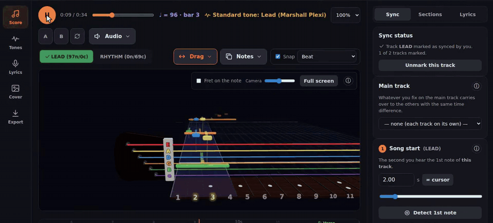
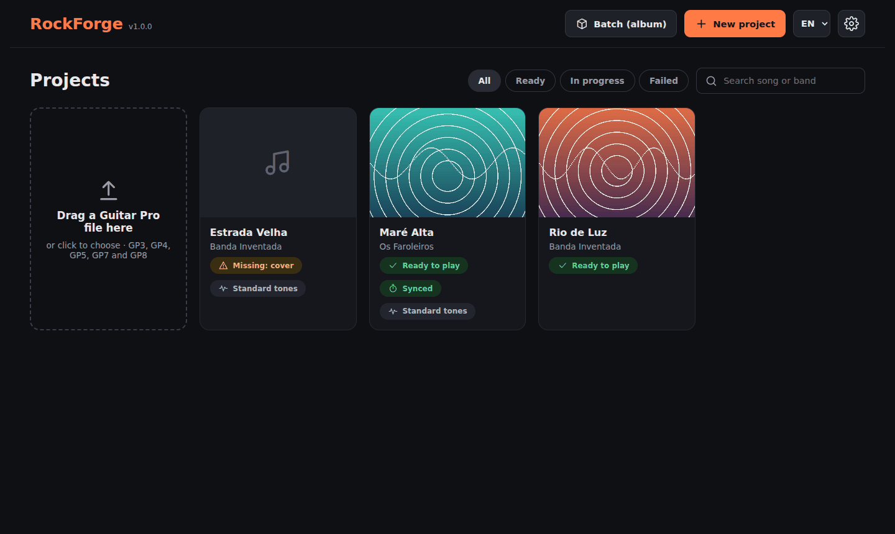
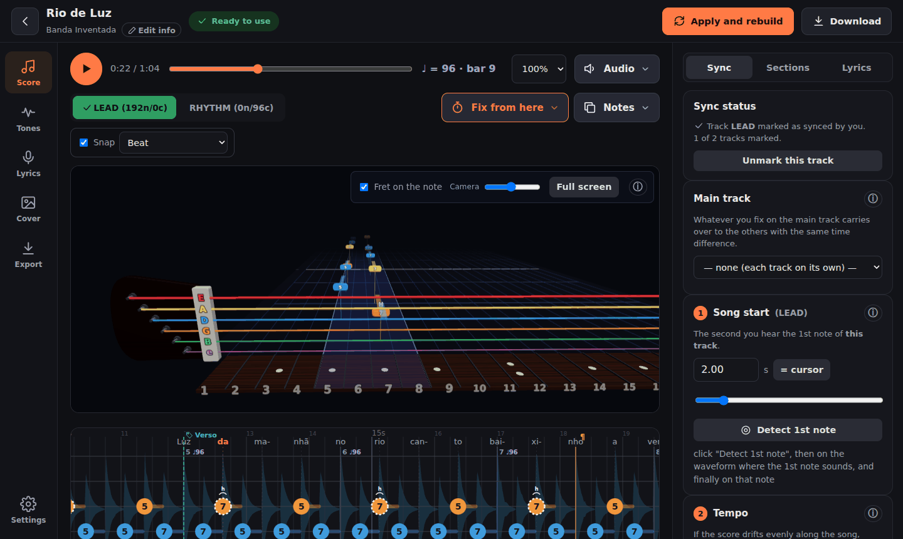
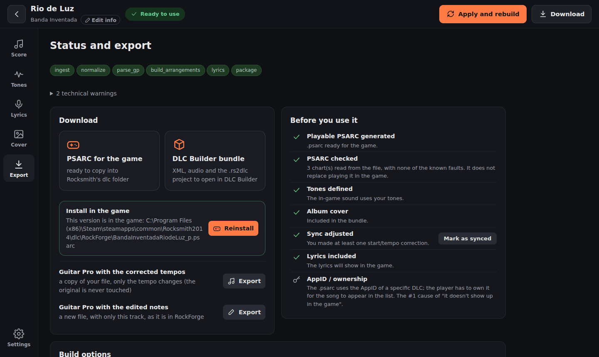
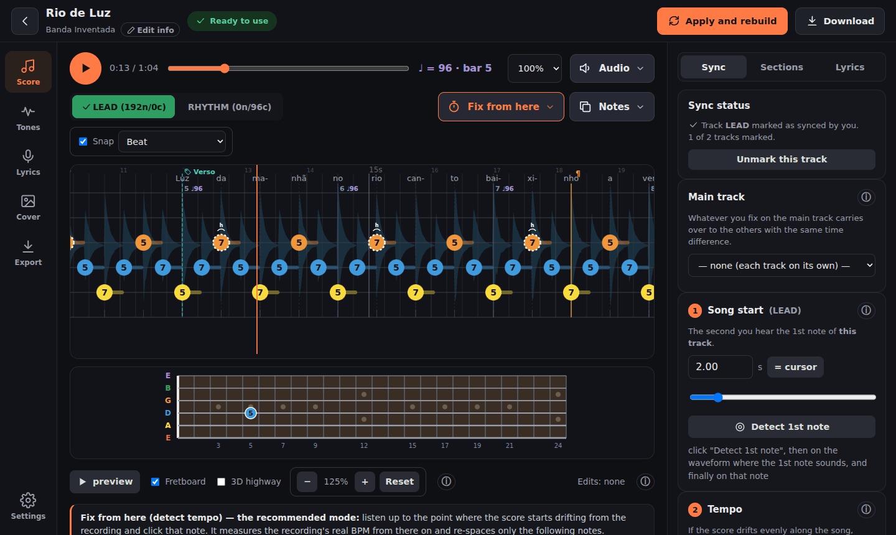

# RockForge

**English** · [Português](README.pt.md)

Turn a **Guitar Pro file** — or a PDF or picture of a tab, or a Songsterr link — and the song's
**recording** into a **Rocksmith 2014 custom song (CDLC)**: a playable `.psarc` and a DLC Builder
project. **Beta**: ready to use, still being tested before 1.0.
Line the notes up with the recording by ear, edit notes, tones and lyrics, and install the
song in the game with one click.

[](LICENSE)
[](https://github.com/F100Pilot/RockForge/releases)
[](https://github.com/F100Pilot/RockForge/actions/workflows/ci.yml)

[](https://paypal.me/F100Pilot)

[](docs/media/tutorial-en.mp4)

▶ **[Watch the tutorial](docs/media/tutorial-en.mp4)** (9 min, captions and chapters): every page of the app, from a Guitar Pro file to the song installed in the game.

## Features

- **Reads Guitar Pro 3, 4, 5 and 7/8 (`.gp`)** exactly: notes, frets, techniques (bends, slides,
  hammer-ons/pull-offs, palm mute, harmonics, vibrato, ties), tempo changes, sections and lyrics.
  Repeats, voltas and D.S./D.C. jumps are played in order.
- **No Guitar Pro file?** Import the tab from a **Songsterr** link (with the per-bar video timings
  people marked there), or convert a **PDF or picture** of the tab with
  [PDF-to-GP5](https://github.com/F100Pilot/PDF-to-GP5).
- **The recording**: your audio file, the audio inside a Guitar Pro 8 file, or the audio of a
  YouTube video.
- **Both outputs, always**: a native, playable **`.psarc`** and a **DLC Builder** project (`.rs2dlc`
  + Song2014 XML + audio + cover), so you can finish or adjust the song in DLC Builder.
- **Lead, Rhythm, Combo and alternate arrangements**, each synced on its own and named as the game
  names them.
- **Sync you check by ear**: song start, a BPM stretch, "Fix from here" (pin a note, measure the
  tempo from there on), drag notes or whole passages, align a bar. Guitar Pro 8 sync points are used
  directly.
- **Edit on the score**: frets, techniques, insert or delete notes, copy and paste, sections.
- **Tones** with the game's amps, cabinets and pedals; tone changes during the song; a tone
  suggested for each part; the tones of the songs you already own, read from your `dlc` folder.
- **Lyrics** from the Guitar Pro file, LRCLIB or the recording (WhisperX), synced to the voice and
  editable word by word.
- **Dynamic difficulty**, chord fingering and hand shapes in the native `.psarc`.
- **Check the `.psarc`** against the faults that made the game crash before, and **install it** in
  the game's `dlc` folder.
- **3D note highway** in the style of Rocksmith, to check the sync while the song plays.
- **Portuguese and English** interface. Runs on your computer; nothing is uploaded.

| | |
|---|---|
|  |  |
|  |  |

### Tutorial video

[tutorial-en.mp4](docs/media/tutorial-en.mp4) — made with an invented song, every step on screen with a caption:

| | |
|---|---|
| 0:10 | The home page |
| 0:26 | New project: file, tracks, recording, details |
| 1:40 | The Score page: playback, tracks, audio sources, A–B repeat |
| 2:38 | Syncing the notes: song start, tempo, corrections, marking a track as synced |
| 4:11 | Editing notes, sections and lyrics on the score |
| 5:21 | The 3D highway and the fretboard |
| 6:02 | Tones |
| 7:03 | Lyrics, cover and song information |
| 7:23 | Apply and rebuild |
| 7:43 | Export, check and install in the game |
| 8:20 | Settings and batch (album) |

## What it does not do

- **It does not transcribe audio into notes.** The notes come from a tab (Guitar Pro, Songsterr,
  PDF). Automatic transcription was measured at about one note in three on real songs, so it is not
  offered.
- **Sync is checked by you.** The tools make it quick, but you confirm each track by ear.
- **Guitar Pro 6** (`.gpx`) files are not supported — export them as GP5 or GP7. A 6-string bass
  is charted as a guitar (a Rocksmith bass has four strings; a 5-string one is folded onto four).
- Tones are chosen from the game's gear by character; the real amp of a recording is not
  identified.

## Get started

**Windows — the installer (easiest)**

1. Download `RockForge-<version>-Setup.exe` (or the portable `.zip`) from
   [Releases](https://github.com/F100Pilot/RockForge/releases) — currently a **beta**.
2. Run it. The installer is not code-signed, so Windows SmartScreen may warn: *More info* →
   *Run anyway*. `SHA256SUMS.txt` beside it lets you check the download.
3. Open RockForge from the Start menu. It opens in its own window; no Python, and ffmpeg is
   included.

The installed version covers the whole Guitar Pro → CDLC path. The **extra components** —
importing a **PDF/picture** of the tab, the **detection** features (stems, lyrics, tone, *Fix from
here*) and downloading a **YouTube** video's audio — are installed by the app itself: tick them in
the installer (on by default) or click *Install now* on the home page. RockForge downloads a
Python 3.11 of its own with those packages (about 1 GB, or 3 GB with an NVIDIA GPU) into a folder
that touches nothing else. The app also tells you when a new version is out.

**What you need in both cases**

- For a **playable `.psarc`**: **Wwise** 2019, 2021, 2022 or 2023, installed with the Audiokinetic
  Launcher (free, with an account; its licence does not allow shipping it with the app). RockForge
  finds it where the Launcher puts it and warns on the home page while it is missing. Without it
  you still get the DLC Builder project.
- For the song to **appear in the game**: the CDLC patch (`D3DX9_42.dll`) in the Rocksmith 2014
  folder, as for any CDLC.

**Windows — from the source (every feature, updates itself)**

1. Install **Python 3.11** exactly ([python.org](https://www.python.org/downloads/), tick *Add
   Python to PATH*, or `winget install Python.Python.3.11`) and **ffmpeg** (`winget install ffmpeg`).
2. `git clone https://github.com/F100Pilot/RockForge.git` (or download the source zip), then
   double-click `start.bat`. The first run installs what is needed (several GB for the
   stem/lyric/tone detection) and takes a while; later runs update it.
3. The app opens in the browser at `http://localhost:8000`. Closing the tab stops it.

**macOS / Linux**

```bash
python3.11 -m pip install -e ".[psarc]"          # add ml,lyrics for the detection features
ROCKFORGE_WORKER_MODE=inprocess python3.11 -m uvicorn rockforge.interfaces.api.app:app --port 8000
```

Then open `http://localhost:8000`. The full installation guide — the GPU, the standalone `.exe`,
Docker and every setting — is in the [technical documentation](docs/TECHNICAL.md).

## Documentation

| | English | Português |
|---|---|---|
| User guide | [GUIDE.en.md](docs/GUIDE.en.md) | [GUIA.md](docs/GUIA.md) |
| Tutorial video | [tutorial-en.mp4](docs/media/tutorial-en.mp4) | [tutorial-pt.mp4](docs/media/tutorial-pt.mp4) |
| Technical documentation (install, configuration, build, Docker) | [TECHNICAL.md](docs/TECHNICAL.md) | [TECNICO.md](docs/TECNICO.md) |
| What's new | [CHANGELOG.en.md](CHANGELOG.en.md) | [CHANGELOG.md](CHANGELOG.md) |
| Tests and the manual checks CI cannot do | [TESTING.md](TESTING.md) | |
| Design and constraints of every feature (for developers) | [CLAUDE.md](CLAUDE.md) | |
| Legal notice | [LEGAL.md](LEGAL.md) | [LEGAL.md](LEGAL.md) |

## Support the project

RockForge is free. If it saves you time, you can buy me a coffee:

[](https://paypal.me/F100Pilot)

Bug reports and ideas are welcome in [Issues](https://github.com/F100Pilot/RockForge/issues). See
[CONTRIBUTING.md](CONTRIBUTING.md).

## Licence and notices

- The code is under the [MIT licence](LICENSE). Third-party code and data keep their own licences
  ([THIRD_PARTY_NOTICES.md](THIRD_PARTY_NOTICES.md)).
- RockForge contains no songs and no Ubisoft content. Use it only with tabs and recordings you have
  the rights to use; distributing CDLC made from copyrighted recordings is unauthorised
  distribution. The terms of Songsterr, YouTube, LRCLIB and the cover services apply to whoever
  uses them. Full text: [LEGAL.md](LEGAL.md).
- Rocksmith is a trademark of Ubisoft Entertainment, and Guitar Pro of Arobas Music. This project
  is not affiliated with or endorsed by either.
