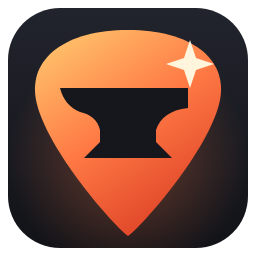
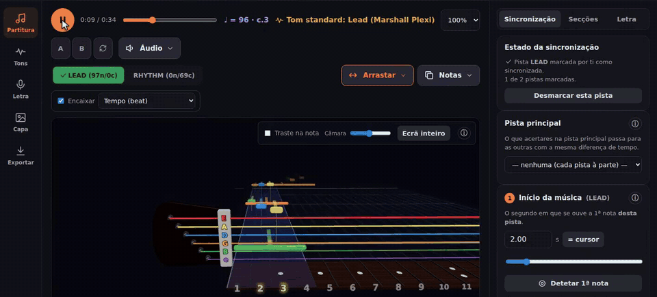
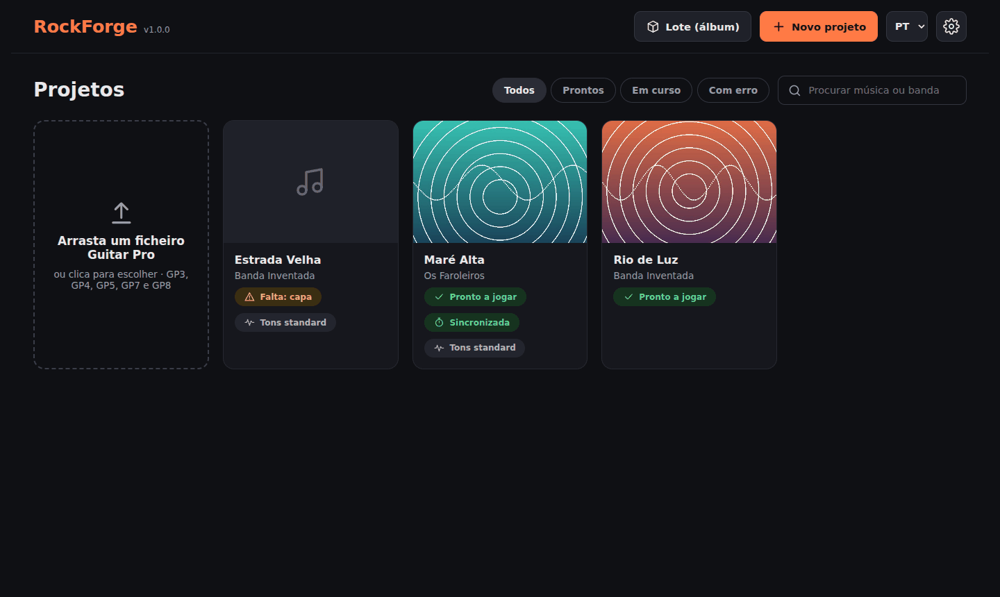
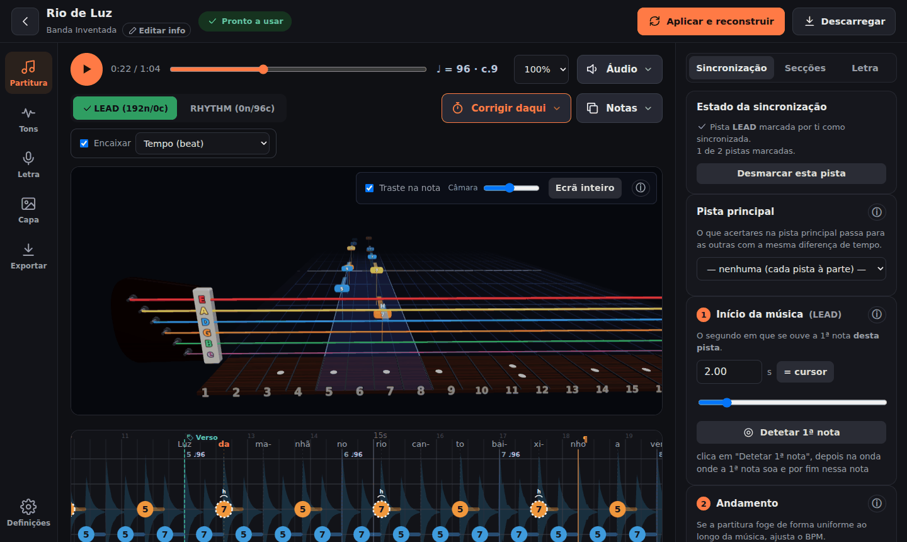
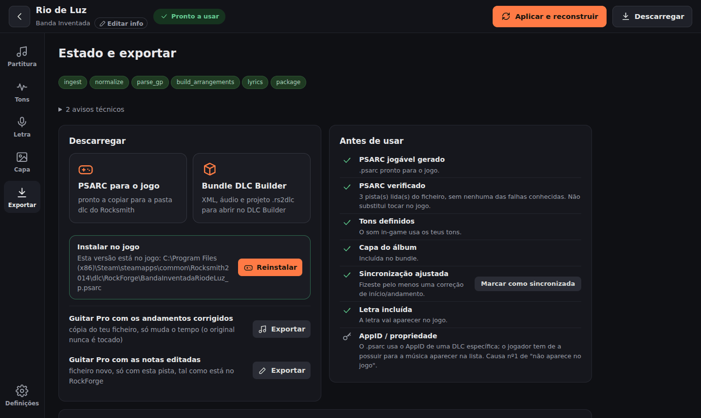
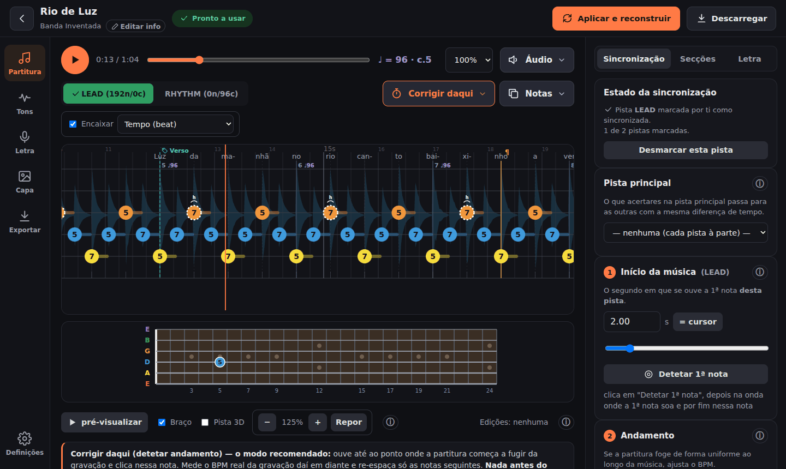

#  RockForge

[English](README.md) · **Português**

Transforma um **ficheiro Guitar Pro** — ou o PDF ou uma imagem de uma tablatura, ou um link do
Songsterr — e a **gravação** da música numa **música personalizada para o Rocksmith 2014 (CDLC)**:
um `.psarc` jogável e um projeto do DLC Builder. **Beta**: pronto a usar, ainda em testes antes
da 1.0. Acerta as notas à gravação de ouvido, edita notas,
tons e letra, e instala a música no jogo com um clique.

[](LICENSE)
[](https://github.com/F100Pilot/RockForge/releases)
[](https://github.com/F100Pilot/RockForge/actions/workflows/ci.yml)

[](https://paypal.me/F100Pilot)

[](docs/media/tutorial-pt.mp4)

▶ **[Ver o vídeo tutorial](docs/media/tutorial-pt.mp4)** (10 min, com legendas e capítulos): todas as páginas da aplicação, de um ficheiro Guitar Pro até à música instalada no jogo.

## O que faz

- **Lê Guitar Pro 3, 4, 5 e 7/8 (`.gp`)** com exatidão: notas, trastes, técnicas (bends, slides,
  hammer-ons/pull-offs, palm mute, harmónicos, vibrato, ligaduras), mudanças de andamento, secções
  e letra. As repetições, voltas e saltos D.S./D.C. são tocados pela ordem.
- **Sem ficheiro Guitar Pro?** Importa a tab de um link do **Songsterr** (com os tempos de cada
  compasso no vídeo, marcados por pessoas), ou converte um **PDF ou imagem** da tab com o
  [PDF-to-GP5](https://github.com/F100Pilot/PDF-to-GP5).
- **A gravação**: o teu ficheiro de áudio, o áudio que vem dentro de um ficheiro Guitar Pro 8, ou o
  áudio de um vídeo do YouTube.
- **As duas saídas, sempre**: um **`.psarc`** nativo e jogável e um projeto do **DLC Builder**
  (`.rs2dlc` + XML Song2014 + áudio + capa), para poderes acabar ou ajustar a música no DLC Builder.
- **Arranjos Lead, Rhythm, Combo e alternativos**, cada um sincronizado à parte e com o nome que o
  jogo lhe dá.
- **Sincronização que confirmas de ouvido**: início da música, ajuste do BPM, "Corrigir daqui"
  (fixa uma nota e mede o andamento daí em diante), arrastar notas ou trechos inteiros, alinhar um
  compasso. Os pontos de sincronização do Guitar Pro 8 são usados diretamente.
- **Editar na partitura**: trastes, técnicas, inserir ou apagar notas, copiar e colar, secções.
- **Tons** com os amplificadores, colunas e pedais do jogo; mudanças de tom ao longo da música; um
  tom sugerido para cada parte; os tons das músicas que já tens, lidos da tua pasta `dlc`.
- **Letra** do ficheiro Guitar Pro, do LRCLIB ou da gravação (WhisperX), sincronizada com a voz e
  editável palavra a palavra.
- **Dificuldade dinâmica**, dedilhação dos acordes e formas de mão no `.psarc` nativo.
- **Verificar o `.psarc`** contra as falhas que já fizeram o jogo fechar, e **instalá-lo** na pasta
  `dlc` do jogo.
- **Pista 3D** ao estilo do Rocksmith, para confirmar a sincronização enquanto a música toca.
- Interface em **português e inglês**. Corre no teu computador; nada é enviado para fora.

| | |
|---|---|
|  |  |
|  |  |

### Vídeo tutorial

[tutorial-pt.mp4](docs/media/tutorial-pt.mp4) — feito com uma música inventada, cada passo no ecrã com uma legenda:

| | |
|---|---|
| 0:10 | A página inicial |
| 0:26 | Novo projeto: ficheiro, pistas, gravação, detalhes |
| 1:40 | A página Partitura: reprodução, pistas, fontes de áudio, repetir um trecho |
| 2:42 | Sincronizar as notas: início, andamento, correções, marcar a pista como sincronizada |
| 4:14 | Editar notas, secções e letra na partitura |
| 5:25 | A pista 3D e o braço da guitarra |
| 6:08 | Tons |
| 7:19 | Letra, capa e informação da música |
| 7:39 | Aplicar e reconstruir |
| 8:11 | Exportar, verificar e instalar no jogo |
| 8:52 | Definições e lote (álbum) |

## O que não faz

- **Não transcreve áudio em notas.** As notas vêm de uma tablatura (Guitar Pro, Songsterr, PDF). A
  transcrição automática foi medida em cerca de uma nota em cada três em músicas reais, por isso
  não é oferecida.
- **A sincronização é confirmada por ti.** As ferramentas tornam-na rápida, mas cada pista
  confirma-se de ouvido.
- Ficheiros **Guitar Pro 6** (`.gpx`) não são suportados — exporta-os como GP5 ou GP7. Um baixo
  de 6 cordas faz-se como guitarra (o baixo do Rocksmith tem quatro cordas; um de 5 é dobrado em
  quatro).
- Os tons são escolhidos entre o equipamento do jogo pelo carácter do som; o amplificador real de
  uma gravação não é identificado.

## Começar

**Windows — o instalador (o mais simples)**

1. Descarrega o `RockForge-<versão>-Setup.exe` (ou o `.zip` portátil) em
   [Releases](https://github.com/F100Pilot/RockForge/releases) — por agora, uma **beta**.
2. Executa-o. O instalador não tem assinatura digital, por isso o SmartScreen do Windows pode
   avisar: *Mais informações* → *Executar mesmo assim*. O `SHA256SUMS.txt` ao lado permite
   confirmar o ficheiro.
3. Abre o RockForge no menu Iniciar. Abre numa janela própria; não precisa de Python e o ffmpeg
   já vem incluído.

A versão instalada cobre todo o caminho Guitar Pro → CDLC. Os **componentes extra** — importar um
**PDF/imagem** da tablatura, as funções de **deteção** (stems, letra, tom, *Corrigir daqui*) e
descarregar o áudio de um vídeo do **YouTube** — instala-os a própria aplicação: marca-os no
instalador (vêm marcados) ou carrega em *Instalar agora* na página inicial. O RockForge descarrega
um Python 3.11 só seu com esses pacotes (cerca de 1 GB, ou 3 GB com uma GPU NVIDIA) para uma pasta
que não mexe em mais nada. A aplicação também avisa quando sai uma versão nova.

**O que precisas nos dois casos**

- Para um **`.psarc` jogável**: o **Wwise** 2019, 2021, 2022 ou 2023, instalado com o Audiokinetic
  Launcher (gratuito, com conta; a licença não permite distribuí-lo com a aplicação). O RockForge
  encontra-o onde o Launcher o põe e avisa na página inicial enquanto faltar. Sem ele sai na
  mesma o projeto do DLC Builder.
- Para a música **aparecer no jogo**: o patch de CDLC (`D3DX9_42.dll`) na pasta do Rocksmith 2014,
  como para qualquer CDLC.

**Windows — a partir do código (todas as funções, atualiza-se sozinho)**

1. Instala o **Python 3.11**, exatamente ([python.org](https://www.python.org/downloads/), com
   *Add Python to PATH* marcado, ou `winget install Python.Python.3.11`) e o **ffmpeg**
   (`winget install ffmpeg`).
2. `git clone https://github.com/F100Pilot/RockForge.git` (ou descarrega o zip do código) e faz
   duplo clique no `start.bat`. A primeira vez instala o necessário (vários GB para a deteção de
   stems, letra e tom) e demora; das outras vezes atualiza-o.
3. A aplicação abre no browser em `http://localhost:8000`. Fechar o separador desliga-a.

**macOS / Linux**

```bash
python3.11 -m pip install -e ".[psarc]"          # junta ml,lyrics para as funções de deteção
ROCKFORGE_WORKER_MODE=inprocess python3.11 -m uvicorn rockforge.interfaces.api.app:app --port 8000
```

Depois abre `http://localhost:8000`. O guia de instalação completo — a GPU, o `.exe` autónomo, o
Docker e todas as definições — está na [documentação técnica](docs/TECNICO.md).

## Documentação

| | Português | English |
|---|---|---|
| Guia do utilizador | [GUIA.md](docs/GUIA.md) | [GUIDE.en.md](docs/GUIDE.en.md) |
| Vídeo tutorial | [tutorial-pt.mp4](docs/media/tutorial-pt.mp4) | [tutorial-en.mp4](docs/media/tutorial-en.mp4) |
| Documentação técnica (instalação, configuração, compilação, Docker) | [TECNICO.md](docs/TECNICO.md) | [TECHNICAL.md](docs/TECHNICAL.md) |
| Novidades | [CHANGELOG.md](CHANGELOG.md) | [CHANGELOG.en.md](CHANGELOG.en.md) |
| Testes e as verificações manuais que o CI não faz | | [TESTING.md](TESTING.md) |
| Desenho e restrições de cada funcionalidade (para programadores) | | [CLAUDE.md](CLAUDE.md) |
| Aviso legal | [LEGAL.md](LEGAL.md) | [LEGAL.md](LEGAL.md) |

## Apoiar o projeto

O RockForge é gratuito. Se te poupa tempo, podes pagar-me um café:

[](https://paypal.me/F100Pilot)

Relatos de erros e ideias são bem-vindos nas [Issues](https://github.com/F100Pilot/RockForge/issues).
Vê o [CONTRIBUTING.md](CONTRIBUTING.md).

## Licença e avisos

- O código está sob a [licença MIT](LICENSE). O código e os dados de terceiros mantêm as suas
  licenças ([THIRD_PARTY_NOTICES.md](THIRD_PARTY_NOTICES.md)).
- O RockForge não contém músicas nem conteúdo da Ubisoft. Usa-o só com tablaturas e gravações que
  tens o direito de usar; distribuir CDLC feitos a partir de gravações protegidas é distribuição não
  autorizada. Os termos do Songsterr, do YouTube, do LRCLIB e dos serviços de capas aplicam-se a
  quem os usa. Texto completo: [LEGAL.md](LEGAL.md).
- Rocksmith é uma marca da Ubisoft Entertainment, e Guitar Pro da Arobas Music. Este projeto não
  tem ligação a nenhuma delas nem é aprovado por elas.
